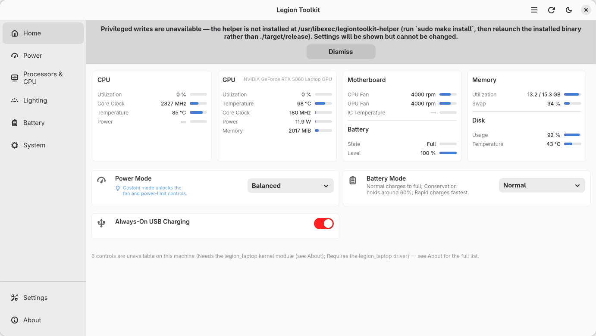
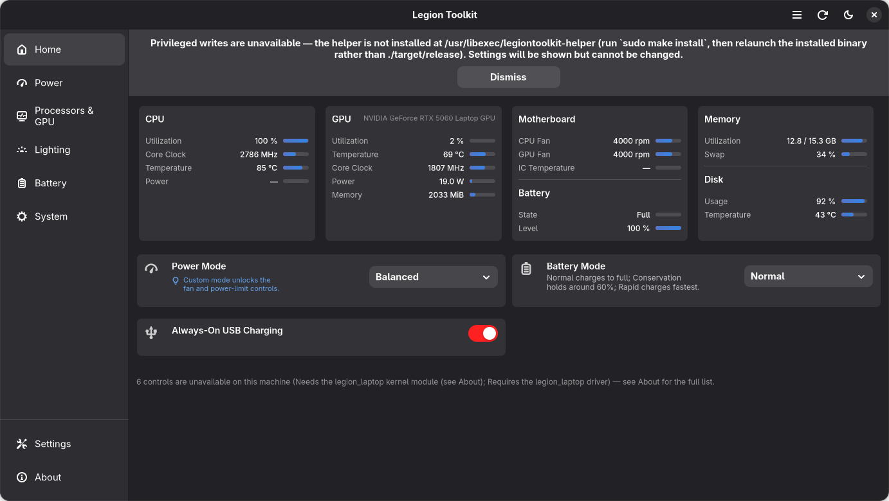
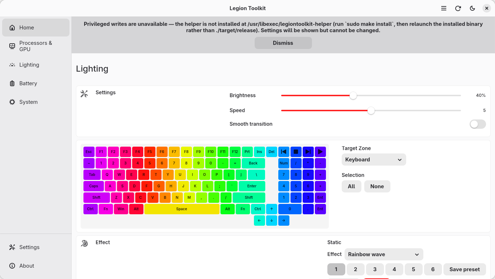
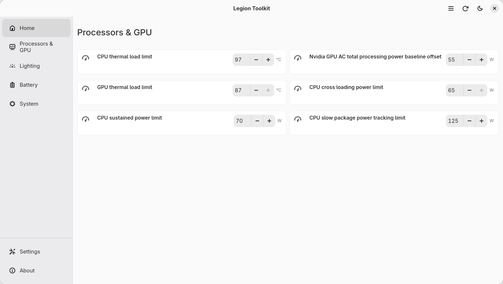
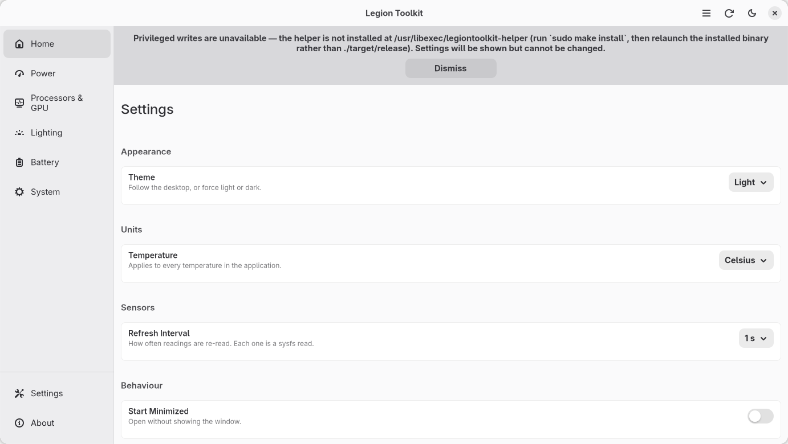
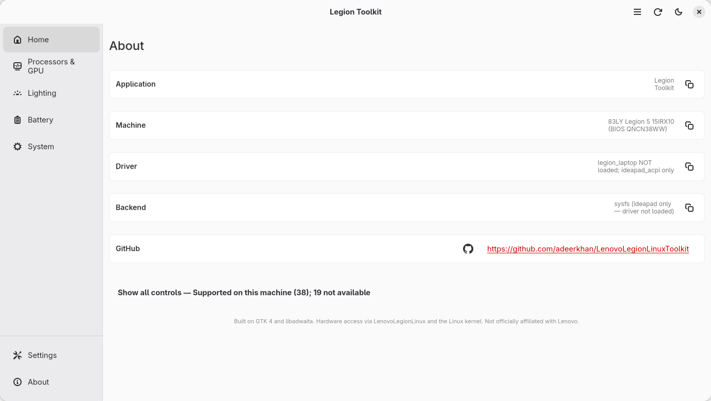

# Legion Toolkit

A native GTK 4 / libadwaita control panel for **Lenovo Legion** laptops — power
modes, thermals, fans, GPU working mode, battery charging, the 24-zone RGB
keyboard, and presets.

Written in Rust on GTK 4 and libadwaita, so it reads as a first-class citizen of
the GNOME desktop rather than a port of a Windows application.

*Not officially affiliated with, endorsed by, or sponsored by Lenovo.*

**[Project plan](docs/PLAN.md)** · **[Architecture](docs/architecture.md)** · **[Data sources](docs/data-sources.md)** · **[Hardware compatibility](docs/hardware-compatibility.md)** · **[Hardware validation](docs/hardware-validation.md)**

---

## Screenshots

**Home — light**



**Home — dark**



**Lighting — the 24-zone RGB editor**



**Processors & GPU**



**Settings**



**About**



## Table of contents

- [Features](#features)
- [Why capability-first](#why-capability-first)
- [Compatibility](#compatibility)
- [Requirements](#requirements)
- [What gets installed](#what-gets-installed--and-where-the-sensor-data-comes-from)
- [Installation](#installation)
- [Updating](#updating)
- [Usage](#usage)
- [Troubleshooting](#troubleshooting)
- [Logs](#logs)
- [Contributing](#contributing)
- [Thanks](#thanks)
- [License](#license)

---

## Features

**Dashboard (Home)** — the landing page, laid out the way the Windows original's
is: a row of sensor cards (CPU, GPU, Motherboard + Battery, Memory + Disk) above
titled sections (Power, Graphics, Lighting) holding the headline controls.

| Area | What you can do |
|---|---|
| **Power** | Power mode — Quiet / Balanced / Performance / Custom; Maximum Fan Speed; Battery Mode (normal / conservation / rapid charge); Always-on USB |
| **Processors & GPU** | Power limits from the firmware (PL1, PL2, PL1 tau, CPU cross-loading, GPU cTGP, GPU PPAB, GPU→CPU boost, AC offset, CPU and GPU temperature caps) as sliders; GPU Working Mode (Hybrid / Integrated Only / Hybrid Auto); G-Sync |
| **Thermal** | CPU, GPU, chipset and SSD temperature; CPU and GPU fan speed; CPU utilisation, core clock and package power; GPU utilisation, clock, power and VRAM; memory and swap; disk usage |
| **Lighting** | The **24-zone RGB keyboard**: a keyboard-shaped editor, per-zone colours, six presets, hardware effects (static, spiral rainbow, rainbow wave, colour change / pulse / wave, smooth), brightness and speed; Y-logo and IO-port lights |
| **Battery** | Level, status, health, cycle count, voltage, remaining charge, time remaining, observed discharge extremes, time on battery |
| **System** | Fn-lock, touchpad, camera, always-on USB, Windows-key lock, Instant Boot (AC and USB-PD) |
| **Presets** | Named power presets — capture the current power limits and mode into one, apply it later, from every machine |
| **Settings** | Theme, temperature unit, refresh interval, compact mode, start minimised, minimise on close, start on login, update checks |

**Capability-first, not model-first.** Availability varies wildly between models
and even between power modes on the same machine, so the UI is generated from a
live capability report. A control this machine lacks is **not** drawn as a dead
grey switch — it is omitted, with a single sentence at the foot of the page naming
why, and the full list on the About page.

**Reads are unprivileged; each write escalates.** The application runs as your
user and reads hardware directly. A write goes through `polkit` to a small helper
binary, so the process itself never runs as root — which keeps desktop
notifications and session integration working.

## Why capability-first

Legion hardware differs enormously: this project's reference laptop (Legion 5
15IRX10) has **no fan curve and no driver power limits**, while a Legion Pro 7
has both. Rather than branch on a model name, every capability reports whether it
is available and, when it is not, *why* — "needs the kernel module" and "your
hardware does not have this" are different problems needing different actions,
and a disabled switch cannot tell them apart.

## Compatibility

- **Any Legion laptop**, with or without the out-of-tree driver.
- Verified in depth on a **Lenovo Legion 5 15IRX10 (83LY, BIOS QNCN38WW)**,
  kernel 7.2, Fedora 44 — including the 24-zone RGB keyboard.
- Batteries, readings and the sensor row work with **no driver at all**; the
  kernel's in-tree drivers already expose them.
- **RGB keyboards**: Lenovo Gen10 24-zone (`048d:c195`) and per-key+chassis
  (`048d:c197`). Other keyboards still get the WMI on/off/brightness control.
- AMD and Intel CPUs; NVIDIA GPUs via `nvidia-smi`; AMD GPUs read from sysfs.

## Requirements

**To build** — a Rust toolchain (1.85+) and the GTK development headers:

```sh
# Fedora
sudo dnf install gtk4-devel libadwaita-devel pango-devel \
    gdk-pixbuf2-devel cairo-gobject-devel graphene-devel
```

**To run**:

- **GTK 4.22 or newer and libadwaita 1.9 or newer** (Fedora 44 ships both;
  Ubuntu from 25.10)
- `polkit` for privileged writes
- *Optional*: the **`legion_laptop`** kernel module from
  [LenovoLegionLinux](https://github.com/johnfanv2/LenovoLegionLinux), which adds
  the keyboard backlight, Y-logo and IO-port LEDs, GPU working mode, G-Sync,
  Windows-key lock and Instant Boot

## What gets installed — and where the sensor data comes from

Installing this project installs **this project's binaries and nothing else**:

| Path | What |
|---|---|
| `/usr/bin/legiontoolkit` | the application |
| `/usr/bin/legiontoolkit-keyboard-probe` | a read-only keyboard diagnostic |
| `/usr/libexec/legiontoolkit-helper` | the privileged write helper, invoked per write |
| `/usr/share/polkit-1/actions/org.legiontoolkit.helper.policy` | the polkit action for the helper |
| `/usr/share/applications/legiontoolkit.desktop` | desktop entry |
| `/usr/share/icons/hicolor/…/apps/legiontoolkit.png` | icons |
| `/etc/udev/rules.d/99-legiontoolkit-hidraw.rules` | grants your user access to the RGB keyboard's hidraw node |

The RPM and DEB declare their runtime dependencies (`gtk4`, `libadwaita`,
`polkit`), so those come from your package manager as usual.

**No "sensor library" ships with this application — and none is needed.** All the
readings come from interfaces the **Linux kernel** already exposes:

| Data | Kernel source |
|---|---|
| CPU / chipset temperature, fan speed | `coretemp`, `k10temp`, `hwmon` |
| SSD temperature | `nvme` |
| CPU package power, clock, utilisation | `intel-rapl`, `cpufreq`, `/proc/stat` |
| GPU (temperature, utilisation, clocks, power, VRAM) | `nvidia-smi` — installed by NVIDIA's own driver, not by us |
| Battery, adapter | `power_supply` |
| Power mode | the ACPI platform-profile interface |
| Power limits | the kernel's `firmware-attributes` class |
| Fn-lock, touchpad, camera, USB charging, conservation | `ideapad_acpi` |
| Keyboard colour | the ITE RGB controller over USB (`hidraw`) |

The only extra package worth installing for GPU telemetry is NVIDIA's own driver
(which brings `nvidia-smi`). Everything else is in the kernel you already run.

## Installation

Pick the route for your distribution. Every route except Flatpak installs the
application **and** the privileged helper it needs in one step.

| Distribution | Route |
|---|---|
| Fedora / RHEL | [COPR repository](#fedora--rhel--copr) |
| Ubuntu / Debian | [PPA](#ubuntu--debian--ppa) |
| Any Linux | [Flatpak](#any-linux--flatpak) |
| Arch | [AUR](#arch--aur) |
| Anything else | [From source](#from-source) |

All of them need **GTK 4.22 / libadwaita 1.9** — Fedora 44 and newer, Ubuntu
25.10 "questing" and newer. On an older release, use the Flatpak: it carries its
own runtime.

### Fedora / RHEL — COPR

```sh
sudo dnf copr enable adeerkhan/legion-toolkit
sudo dnf install legiontoolkit
```

Later updates arrive with `sudo dnf upgrade`. The COPR project builds
`packaging/rpm/legiontoolkit.spec`, the same spec `make rpm` builds locally.

### Ubuntu / Debian — PPA

```sh
sudo add-apt-repository ppa:adeerkhan/legion-toolkit
sudo apt install legiontoolkit
```

The PPA builds for **25.10 "questing" and newer**; older releases lack GTK 4.22
and would not start. On an older Ubuntu, use the Flatpak below.
`packaging/ppa/README.md` covers the PPA itself.

### Any Linux — Flatpak

```sh
flatpak install --from https://adeerkhan.github.io/LenovoLegionLinuxToolkit/flatpak/org.legiontoolkit.Ltk.flatpakref
flatpak run org.legiontoolkit.Ltk
```

The Flatpak reads every sensor row and drives the RGB keyboard by itself, out of
the box: readings come from `/sys` and `/proc`, and the keyboard over
`/dev/hidraw*`. The one thing a sandbox cannot do alone is a **privileged
write** — the helper is a host binary — so install the helper once with the COPR
package, the PPA, or `make install` below. Privileged writes then go through
`flatpak-spawn --host` to that helper, and every toggle and slider works. Without
it the application still reads everything and says so plainly.

`packaging/flatpak/README.md` covers building it, publishing the repository, and
what the sandbox can and cannot reach.

### Arch — AUR

```sh
yay -S legiontoolkit          # or: paru -S legiontoolkit
```

The `PKGBUILD` is in `packaging/aur/`.

### From source

```sh
git clone https://github.com/adeerkhan/LenovoLegionLinuxToolkit.git
cd LenovoLegionLinuxToolkit
sudo make install
legiontoolkit                 # or launch it from your app menu
```

`make install` builds the application and its privileged helper, installs the
polkit policy, desktop entry, icons and the udev rule, and places the helper
exactly where the policy names it. The Makefile owns every destination, so it is
reversible with `make uninstall` and relocatable with a different `PREFIX`.

Prerequisites — a Rust toolchain (1.85 or newer) and the GTK development
headers:

```sh
# Fedora
sudo dnf install gtk4-devel libadwaita-devel pango-devel \
    gdk-pixbuf2-devel cairo-gobject-devel graphene-devel

# Ubuntu / Debian — 25.10 "questing" or newer; older releases lack GTK 4.22
sudo apt install libgtk-4-dev libadwaita-1-dev libpango1.0-dev \
    libgdk-pixbuf-2.0-dev libcairo2-dev libgraphene-1.0-dev
```

Run `make distcheck` first to print the install layout without touching the
system, and `make install PREFIX=~/.local` to install into your home directory.

`make install` also installs the udev rule that lets your user open the RGB
keyboard's hidraw node, so the **Keyboard RGB** card works unprivileged. A
`$HOME` install cannot write `/etc/udev/rules.d`; install that one file manually:

```sh
sudo install -Dm644 packaging/99-legiontoolkit-hidraw.rules \
    /etc/udev/rules.d/99-legiontoolkit-hidraw.rules
sudo udevadm control --reload-rules && sudo udevadm trigger
```

### Privileged writes

Reads need no permissions. Each write escalates through polkit to the helper: the
first write in a session prompts for your password and polkit then remembers the
authorisation (`auth_admin_keep`), so you are not prompted per change.

To drop the prompt for a user sitting at the machine, install the no-password rule
at the same time as the application:

```sh
sudo make install LEGIONTOOLKIT_NO_PASSWORD=1
```

That installs `49-legiontoolkit.rules`, which lets an `active` and `local`
session use the helper without authenticating. It grants nothing beyond the
capabilities this application already exposes — the helper's allowlist and its
destination-root check still apply — and it is reversible:

```sh
sudo rm /etc/polkit-1/rules.d/49-legiontoolkit.rules
```

### Optional: the kernel module

`legion_laptop` from [LenovoLegionLinux](https://github.com/johnfanv2/LenovoLegionLinux)
adds the keyboard backlight, Y-logo and IO-port LEDs, GPU working mode, G-Sync,
Windows-key lock and Instant Boot. Everything backed by `ideapad_acpi` — battery,
Fn-lock, touchpad, camera, always-on USB — and the whole Home sensor row work
without it.

```sh
cd Reference/LenovoLegionLinux/kernel_module
make
sudo make reloadmodule
```

### Uninstall

```sh
# Fedora / RHEL
sudo dnf remove legiontoolkit
sudo dnf copr remove adeerkhan/legion-toolkit

# Ubuntu / Debian
sudo apt remove legiontoolkit
sudo add-apt-repository --remove ppa:adeerkhan/legion-toolkit

# Flatpak
flatpak uninstall org.legiontoolkit.Ltk

# From source
sudo make uninstall           # binaries, policy, desktop entry, icons and rules
```

### Packaging

Every route is built from the same sources under `packaging/`:

- **Fedora / RHEL** — `packaging/rpm/legiontoolkit.spec`; `make rpm` builds it
  locally, and the COPR project builds it from git.
- **Ubuntu / Debian** — `packaging/debian/`; the PPA builds it, and
  `dpkg-buildpackage -b -us -uc` builds it locally.
- **Arch** — `packaging/aur/PKGBUILD`.
- **Flatpak** — `packaging/flatpak/`; `make flatpak` builds it into a local
  repository.
- **Publishing** — `packaging/README.md` has the maintainer steps for the COPR
  project, the PPA and the Flatpak repository; a tagged release builds the RPM
  and the DEB and attaches them to the [releases page](https://github.com/adeerkhan/LenovoLegionLinuxToolkit/releases).

## Updating

On launch, the application asks GitHub's public releases API whether a newer
release exists, and shows a banner with a **Download** button that opens the
release page. That is one HTTPS request to GitHub, once per launch, and you can
turn it off in Settings → Updates.

To take the update:

```sh
cd LenovoLegionLinuxToolkit
git pull && sudo make install
```

or use your package manager if you installed a distribution package.

## Usage

```sh
legiontoolkit                              # the application
LEGIONTOOLKIT_MOCK=1 legiontoolkit         # render the UI with no hardware
LEGIONTOOLKIT_SHOT=/tmp/home.png \
  LEGIONTOOLKIT_PAGE=home legiontoolkit    # render a page to a PNG, no display
```

The mock backend (`LEGIONTOOLKIT_MOCK=1`) drives the whole UI without hardware,
including the unavailable-control path, so development and screenshots never need
the laptop attached.

Other useful commands:

```sh
make check                                  # fmt + clippy + tests — the gate
cargo test --lib --no-default-features      # the library tests, no display needed
sudo ./target/debug/legiontoolkit-keyboard-probe   # read-only RGB keyboard probe
./target/release/legiontoolkit-helper --check      # verify the privileged write path
```

## Troubleshooting

**Nothing changes when I toggle something.** The helper is not installed, or you
launched the binary from `target/` instead of the installed one. The banner at
the top of the window says which; fix with `sudo make install` and relaunch.

**A password prompt on the first write.** Expected — writable hardware files are
`0644 root`. Polkit remembers the authorisation for the session. To drop it, see
the no-password option in the installation guide.

**"Requires the legion_laptop kernel module".** The control is driver-backed and
the out-of-tree module is not loaded:

```sh
cd Reference/LenovoLegionLinux/kernel_module
make && sudo make reloadmodule
```

**"The firmware is not accepting changes to this in the current power mode."**
Several power limits only accept writes in Custom mode. Switch the power mode
first; the control then becomes live.

**Keyboard RGB says permission denied.** The udev rule is missing (common with a
`PREFIX=~/.local` install). Install it by hand:

```sh
sudo install -Dm644 packaging/99-legiontoolkit-hidraw.rules \
    /etc/udev/rules.d/99-legiontoolkit-hidraw.rules
sudo udevadm control --reload-rules && sudo udevadm trigger
```

**Warnings about `vkAcquireNextImageKHR` / swapchains.** GTK's Vulkan renderer on
NVIDIA/Wayland; cosmetic, not from this application. Launch with
`GSK_RENDERER=ngl legiontoolkit` to use the GL renderer instead.

## Logs

The application logs through `tracing`, so the level is set with `RUST_LOG`:

```sh
RUST_LOG=debug legiontoolkit 2>&1 | tee legion-toolkit.log
```

For a bug report, include that log plus the About page's machine and driver
strings — every row there has a copy button, so they can be pasted straight in.

## Contributing

`make check` is the gate this project must pass: `cargo fmt --check`,
`cargo clippy --all-targets -- -D warnings`, and `cargo test --no-default-features`.
The library half is deliberately GTK-free so the capability, path-resolution,
policy and RGB-protocol layers are testable with no display.

Bug reports are welcome with the log and About strings above.

## Thanks

This project stands on a lot of other people's reverse engineering.

- **[LenovoLegionLinux](https://github.com/johnfanv2/LenovoLegionLinux)** by John
  Fan — the kernel driver and userspace toolkit that makes every hardware
  capability this application exposes possible. Its documentation of the DMI
  allowlist and the per-model capability matrix is what made writing correct code
  on an undocumented machine possible; the vendored copy under `Reference/` was
  the hardware reference throughout.
- **[keyRGB](https://github.com/Rainexn0b/keyRGB)** by Rainexn0b — the Linux tray
  app whose reverse engineering of the Lenovo Gen10 **24-zone ITE keyboard
  controller** is the basis of this project's own RGB implementation
  (`src/rgb.rs`) and its zone mapping. No keyRGB code is copied: the USB report
  layout is reimplemented from its published backend, and its udev rule pattern
  is what ours follows. The RGB controls on this application's Lighting page
  exist because that work came first.
- **[Lenovo Legion Toolkit](https://github.com/LenovoLegionToolkit-Team/LenovoLegionToolkit)** —
  the Windows original, and the reference for the feature set, information
  architecture and visual language reproduced here. The copy vendored under
  `Reference/` is theirs.
- **Vitals** (by corecoding / tjormola) — the GNOME Shell extension whose global
  `hwmon` sweep taught this project to find fan RPM where a driver-specific
  lookup found none.

No code is copied from any of them. This project reimplements interfaces and
behaviour, and communicates across documented boundaries.

## License

GPL-3.0-or-later — see [LICENSE](LICENSE).

Not officially affiliated with Lenovo.
